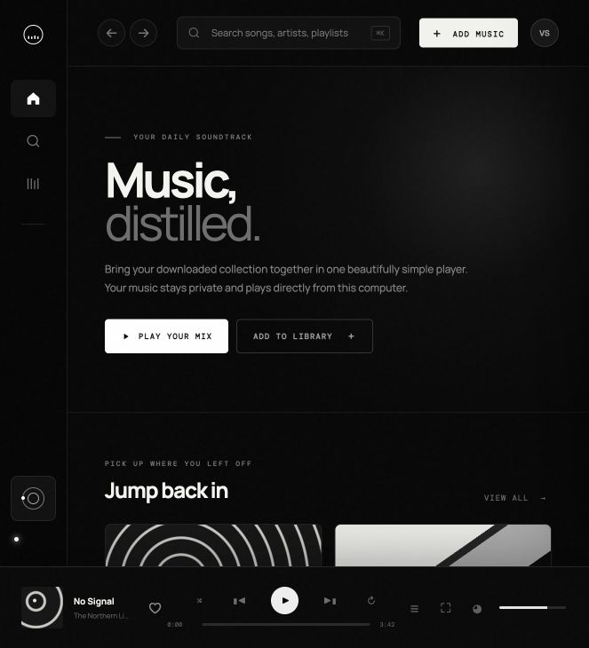
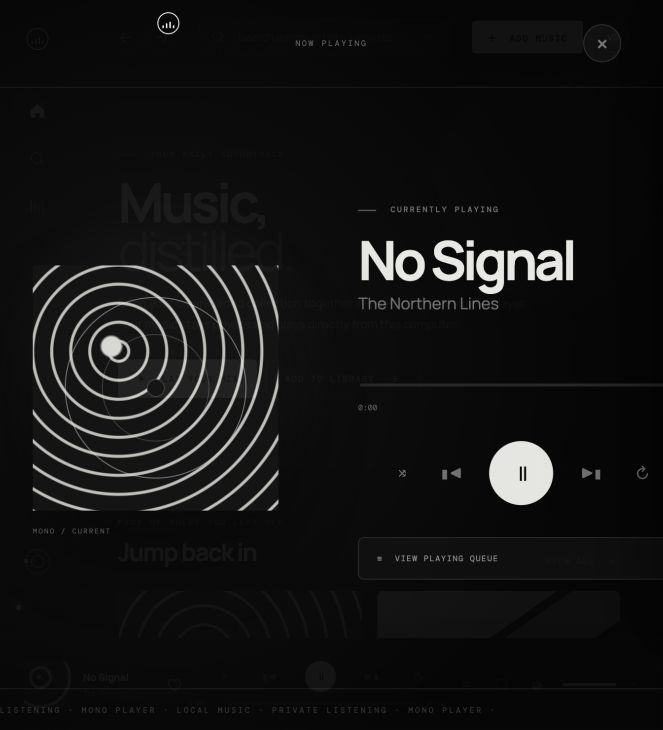
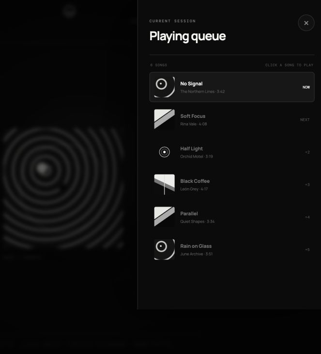

<div align="center">

# MONO

### Your downloaded music, distilled.

A private, monochrome music player that runs entirely in the browser.



</div>

## About

Mono is a lightweight local music player for people who keep their own downloaded audio collection. Add songs from your computer, search your library, manage the playing queue, and switch to a focused full-screen player—all without creating an account or uploading your music.

The project is plain HTML, CSS, and JavaScript. It has no framework, dependency installation, build process, analytics, or backend.

## Features

- Import several downloaded songs at once
- Drag-and-drop MP3, M4A, AAC, WAV, OGG, and browser-supported FLAC files
- Store the local library in IndexedDB so it survives page reloads
- Search tracks, artists, and albums
- Play, pause, seek, adjust volume, shuffle, and repeat
- Inspect the playing queue and jump directly to another song
- Open a focused full-screen Now Playing view
- Responsive black-and-white interface
- Keyboard shortcuts for search and playback
- Local-first privacy: audio files never leave the browser

## Screenshots

| Full-screen player | Playing queue |
| --- | --- |
|  |  |

## Run locally

No installation or build step is required. Clone or download the repository, then serve its directory with a local web server:

```bash
git clone https://github.com/YOUR_USERNAME/mono-music-player.git
cd mono-music-player
python3 -m http.server 4173
```

Open [http://127.0.0.1:4173](http://127.0.0.1:4173) in your browser.

> Opening `index.html` directly is not recommended because persistent browser storage works more reliably from an HTTP origin.

## Add music

1. Download music you are permitted to use from your preferred source.
2. Select **Add music** in Mono.
3. Choose one or more audio files, or drag them into the import area.
4. Select any imported song to begin playback.

Filenames written as `Artist - Song.mp3` are automatically separated into artist and song title. Format support depends on the browser and operating system.

## Controls

| Action | Control |
| --- | --- |
| Search | `Cmd/Ctrl + K` |
| Play or pause | `Space` |
| Full-screen player | Select the album artwork or expand icon |
| Playing queue | Select the queue icon |
| Close an overlay | `Esc` |

## Privacy and storage

- Imported audio stays on the current device and is never uploaded by Mono.
- Files are stored in IndexedDB for the exact site origin being used.
- A library imported on `127.0.0.1` is separate from a library imported on a GitHub Pages URL.
- Clearing browser data for the site removes its saved local library.
- GitHub Pages hosts only the player code and bundled screenshots—not the user's songs.

## Project structure

```text
mono-music-player/
├── index.html                 # Application markup
├── styles.css                # Responsive visual design
├── app.js                    # Player, queue, imports, and storage
├── README.md                 # Project documentation
├── .gitignore                # Files excluded from Git
├── .nojekyll                 # Direct static hosting on GitHub Pages
└── docs/
    └── images/
        ├── mono-home.jpg
        ├── mono-fullscreen.jpg
        └── mono-queue.jpg
```
